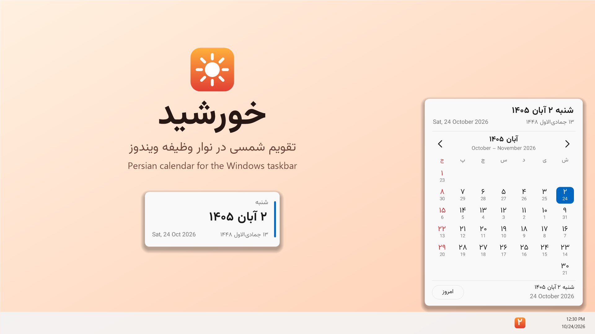
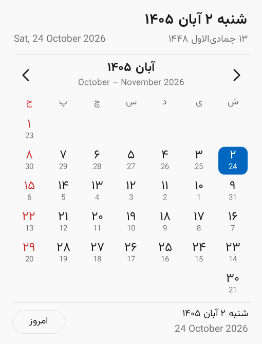
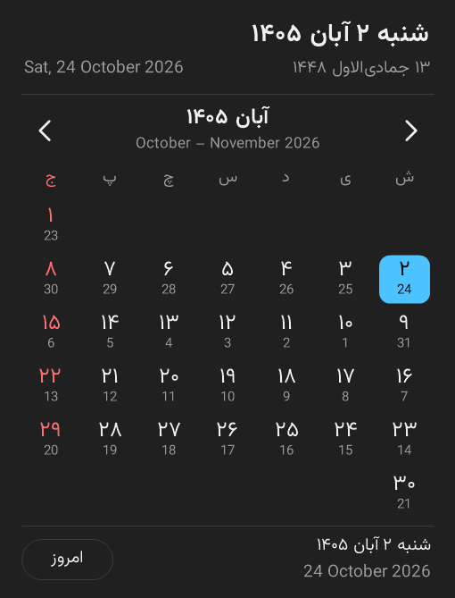
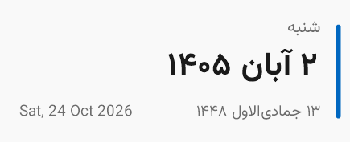
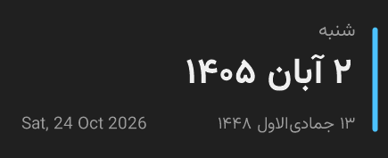

<div align="center">


# Khorshid · خورشید

**The Persian (Solar Hijri) calendar, right in your Windows taskbar.**
<br>
تقویم شمسی، همیشه جلوی چشم شما در نوار وظیفه ویندوز

[](https://github.com/fr2ad/Khorshid/releases/latest)


[](LICENSE)



</div>

## Features

- **Today's Persian date in the tray.** The icon shows the day of the month (۲, ۱۵, ۳۰…); hover for the full date, such as *شنبه ۲ آبان ۱۴۰۵*.
- **Month calendar, one click away.** Saturday-first weeks, Gregorian day numbers under every Persian date, Fridays and official holidays in red, and today's Hijri (lunar) date at the top.
- **Desktop widget.** An optional card with the weekday, date and holiday. Drag it anywhere, pin it above other windows, double-click it to open the calendar.
- **Feels native.** Follows Windows light and dark mode, sharp on high-DPI screens, rounded corners on Windows 11, and RTL throughout.
- **Tiny and private.** A single ~50 KB exe with no dependencies beyond Windows itself. No internet access, no telemetry, no accounts.

<table>
  <tr>
    <td></td>
    <td></td>
  </tr>
  <tr>
    <td></td>
    <td></td>
  </tr>
</table>

## Install

### Option 1: one command (recommended)

Open **PowerShell** and paste:

```powershell
irm https://raw.githubusercontent.com/fr2ad/Khorshid/main/install.ps1 | iex
```

This downloads the latest release into `%LOCALAPPDATA%\Programs\Khorshid`, adds a Start Menu shortcut, sets Khorshid to start when you sign in and launches it. No admin rights needed.

### Option 2: download the exe

1. Download **`Khorshid.exe`** from the [latest release](https://github.com/fr2ad/Khorshid/releases/latest).
2. Move it to a permanent folder, for example `%LOCALAPPDATA%\Programs\Khorshid`.
3. Double-click it. The sun icon with today's date appears in the tray (check behind the **^** arrow if you don't see it, and drag it onto the taskbar to keep it visible).
4. To start it automatically, right-click the tray icon and tick **اجرا هنگام ورود به ویندوز** (start with Windows).

> **"Windows protected your PC"?** The exe isn't code-signed yet, so SmartScreen may warn about an unrecognized app. Click **More info → Run anyway**. The [Microsoft Store](#microsoft-store) version won't show this warning.

### Microsoft Store

A Store version is in preparation; see [`packaging/`](packaging/README.md).

### Uninstall

```powershell
& ([scriptblock]::Create((irm https://raw.githubusercontent.com/fr2ad/Khorshid/main/install.ps1))) -Uninstall
```

Or exit Khorshid from its tray menu and delete its folder and `Khorshid` Start Menu shortcut. Settings live in `%APPDATA%\Khorshid`.

## Using Khorshid

| Action | What happens |
| --- | --- |
| Left-click the tray icon | Open or close the month calendar |
| `‹` `›`, mouse wheel, `←` `→` | Previous / next month |
| **امروز** button or `Home` | Back to today |
| Hover a day | See its full date and holiday in the footer |
| `Esc` or click elsewhere | Close the calendar |
| Right-click the tray icon | Desktop widget, start with Windows, exit |
| Right-click the widget | Keep on top, hide widget |

## Holidays and Hijri dates

Khorshid marks the official holidays that fall on fixed Solar Hijri dates: Nowruz (1–4 Farvardin), 12 and 13 Farvardin, 14 and 15 Khordad, 22 Bahman and 29 Esfand. Religious holidays follow the lunar calendar, move every year and depend on official announcements, so they aren't marked yet. The Hijri date comes from Windows' built-in Hijri calendar and can differ from Iran's official date by a day.

## Build from source

Nothing to install: Windows already includes the C# compiler for .NET Framework 4.x.

```powershell
git clone https://github.com/fr2ad/Khorshid.git
cd Khorshid
.\build.ps1          # produces Khorshid.exe
```

| Path | Contents |
| --- | --- |
| `Khorshid.cs` | The whole app: tray icon, calendar popup, desktop widget |
| `build.ps1` | Builds `Khorshid.exe` |
| `install.ps1` | Per-user installer used by the one-line install |
| `tools/` | `make-assets.ps1` regenerates screenshots, icon and Store logos |
| `packaging/` | MSIX manifest and script for the Microsoft Store |

Khorshid uses the [Vazirmatn](https://github.com/rastikerdar/vazirmatn) font when it's installed and falls back to Segoe UI.

## فارسی

**خورشید** تاریخ شمسی امروز را در نوار وظیفه ویندوز نشان می‌دهد. با یک کلیک تقویم ماه باز می‌شود، با تاریخ میلادی زیر هر روز و تعطیلات رسمی به رنگ قرمز. یک ویجت کوچک هم برای دسکتاپ دارد. برنامه حجم بسیار کمی دارد، به اینترنت وصل نمی‌شود و هیچ اطلاعاتی جمع نمی‌کند.

برای نصب، PowerShell را باز کنید و این دستور را اجرا کنید:

```powershell
irm https://raw.githubusercontent.com/fr2ad/Khorshid/main/install.ps1 | iex
```

## License

[MIT](LICENSE) © 2026 Farzad Farazmand
